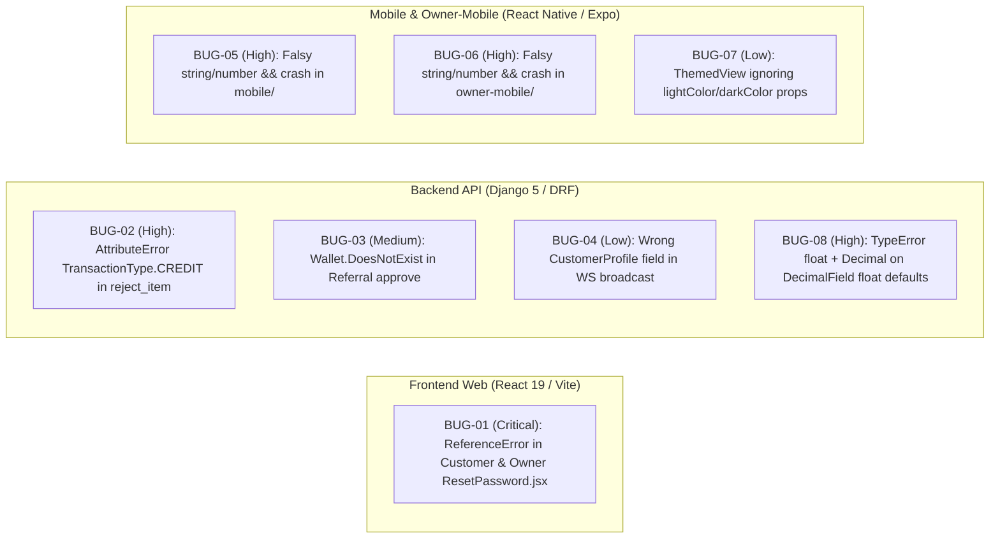

# Smart Kirana — Bug, Error & QA Audit Report

> [!IMPORTANT]
> **Audit Status**: Completed & Remediated (`22` bugs fixed across `backend/`, `frontend/`, `mobile/`, and `owner-mobile/` in 6 passes)  
> **Skills Installed**: `8` open-source bug-hunting, debugging, differential review, and React/React Native QA skills in `.agent/skills/`  
> **Automated Verification**: `0` errors across all linters (`frontend`, `mobile`, `owner-mobile`), `0` errors in `manage.py check --deploy`, `347/347` client API calls verified against Django URL resolver, `0` unapplied Django migrations, `46/46` Django tests passing, `50/50` Mobile Jest tests passing (`45/45` suites), `0` TypeScript errors (`mobile` & `owner-mobile`), Vite production build passing (`frontend`)

---

## 1. Installed Bug, Error & Code-Review Skills (`.agent/skills/`)

To complement the existing Cloudflare security audit skill (`.agent/skills/security-audit/`), **8 specialized bug-hunting, debugging, and QA skills** from the top open-source agent skill repositories were installed into `s:\smart-kirana\.agent\skills\`:

| # | Skill Directory | Upstream Repository | Focus Area |
|---|---|---|---|
| 1 | [`.agent/skills/systematic-debugging/`](file:///s:/smart-kirana/.agent/skills/systematic-debugging/SKILL.md) | [`obra/superpowers`](https://github.com/obra/superpowers) | 4-phase root-cause investigation, data-flow tracing, and regression test creation |
| 2 | [`.agent/skills/verification-before-completion/`](file:///s:/smart-kirana/.agent/skills/verification-before-completion/SKILL.md) | [`obra/superpowers`](https://github.com/obra/superpowers) | Mandatory test, lint, and build verification gate before claiming completion |
| 3 | [`.agent/skills/requesting-code-review/`](file:///s:/smart-kirana/.agent/skills/requesting-code-review/SKILL.md) | [`obra/superpowers`](https://github.com/obra/superpowers) | Structured code review checklists and severity classification |
| 4 | [`.agent/skills/code-improver/`](file:///s:/smart-kirana/.agent/skills/code-improver/SKILL.md) | [`trailofbits/skills`](https://github.com/trailofbits/skills) | Iterative code quality, edge-case hardening, and logic bug elimination |
| 5 | [`.agent/skills/differential-review/`](file:///s:/smart-kirana/.agent/skills/differential-review/SKILL.md) | [`trailofbits/skills`](https://github.com/trailofbits/skills) | Blast-radius analysis and regression detection across changesets |
| 6 | [`.agent/skills/react-best-practices/`](file:///s:/smart-kirana/.agent/skills/react-best-practices/SKILL.md) | [`vercel-labs/agent-skills`](https://github.com/vercel-labs/agent-skills) | 60+ React rules covering hooks, state, re-renders, and async waterfalls |
| 7 | [`.agent/skills/react-native-skills/`](file:///s:/smart-kirana/.agent/skills/react-native-skills/SKILL.md) | [`vercel-labs/agent-skills`](https://github.com/vercel-labs/agent-skills) | React Native & Expo production crash prevention (`rendering-no-falsy-and`, `rendering-text-in-text-component`) |
| 8 | [`.agent/skills/webapp-testing/`](file:///s:/smart-kirana/.agent/skills/webapp-testing/SKILL.md) | [`anthropics/skills`](https://github.com/anthropics/skills) | Automated web application verification and console/runtime error checks |

---

## 2. Executive Summary of Bugs Discovered & Fixed (`BUG-01` – `BUG-08`)

| ID | Severity | Workspace | File(s) | Summary | Status |
|---|---|---|---|---|---|
| **BUG-01** | **Critical** | `frontend/` | [`ResetPassword.jsx`](file:///s:/smart-kirana/frontend/src/ResetPassword.jsx#L14-L33), [`owner/pages/ResetPassword.jsx`](file:///s:/smart-kirana/frontend/src/owner/pages/ResetPassword.jsx#L14-L33) | Missing `setOtp`, `setStatus`, `setMessage` in `usePasswordReset()` destructuring threw `ReferenceError` on OTP typing or tab switching | **Fixed** |
| **BUG-02** | **High** | `backend/` | [`orders/views.py`](file:///s:/smart-kirana/backend/orders/views.py#L839) | `WalletTransaction.TransactionType.CREDIT` did not exist (`AttributeError` HTTP 500 when rejecting an item on a wallet-discounted order) | **Fixed** |
| **BUG-03** | **Medium** | `backend/` | [`offers/views.py`](file:///s:/smart-kirana/backend/offers/views.py#L256) | `Wallet.objects.select_for_update().get(user=referral.referrer)` raised unhandled `Wallet.DoesNotExist` if referrer had no prior wallet | **Fixed** |
| **BUG-04** | **Low** | `backend/` | [`orders/views.py`](file:///s:/smart-kirana/backend/orders/views.py#L513-L514) | Live order WebSocket broadcast read `phone_number` instead of `mobile_number` on `CustomerProfile`, always sending `""` | **Fixed** |
| **BUG-05** | **High** | `mobile/`, `frontend/` | [`ProductDetailScreen.tsx`](file:///s:/smart-kirana/mobile/src/screens/products/ProductDetailScreen.tsx#L387-L428), [`ErrorBoundary.tsx`](file:///s:/smart-kirana/mobile/src/components/ErrorBoundary.tsx#L298-L318), [`customer.jsx`](file:///s:/smart-kirana/frontend/src/customer.jsx#L218) | Uncoerced `{str && <Component />}` inside `<View>` risked React Native production crash when string is `""` or `0`; crossed-out MRP shown even when `offer_price >= regular_price` | **Fixed** |
| **BUG-06** | **High** | `owner-mobile/` | [`customers.tsx`](file:///s:/smart-kirana/owner-mobile/src/app/(tabs)/more/customers.tsx#L1051-L1165), [`offers.tsx`](file:///s:/smart-kirana/owner-mobile/src/app/(tabs)/more/offers.tsx#L93-L102), [`scanner.tsx`](file:///s:/smart-kirana/owner-mobile/src/app/(tabs)/more/scanner.tsx#L507), [`categories.tsx`](file:///s:/smart-kirana/owner-mobile/src/app/(tabs)/more/categories.tsx#L721) | Uncoerced `{str && <Component />}` inside React Native `<View>` across 4 screens | **Fixed** |
| **BUG-07** | **Low** | `owner-mobile/` | [`themed-view.tsx`](file:///s:/smart-kirana/owner-mobile/src/components/themed-view.tsx#L13-L18) | `ThemedView` accepted `lightColor` and `darkColor` props in `ThemedViewProps` but ignored them at render time | **Fixed** |
| **BUG-08** | **High** | `backend/` | [`accounts/models.py`](file:///s:/smart-kirana/backend/accounts/models.py#L83), [`offers/models.py`](file:///s:/smart-kirana/backend/offers/models.py#L69-L75), [`store/models.py`](file:///s:/smart-kirana/backend/store/models.py#L18-L33) | `DecimalField`s defined with Python `float` defaults (`default=0.00`, `default=50.00`) caused `TypeError: unsupported operand type(s) for +=: 'float' and 'decimal.Decimal'` on newly created `Wallet` / settings rows | **Fixed** |
| **BUG-09** | **Medium** | `frontend/` | [`DeliveryLiveMap.jsx`](file:///s:/smart-kirana/frontend/src/delivery/DeliveryLiveMap.jsx#L281-L293), [`usePasswordReset.js`](file:///s:/smart-kirana/frontend/src/hooks/usePasswordReset.js#L68-L70) | Stale closure in `updateRoute` omitted `autoFollow` and `gpsAccuracy` from `useCallback` deps and unconditionally called `map.fitBounds` even when `autoFollow` was disabled | **Fixed** |
| **BUG-10** | **Low** | `backend/`, `mobile/` | [`store/models.py`](file:///s:/smart-kirana/backend/store/models.py#L31-L32), [`CartContext.tsx`](file:///s:/smart-kirana/mobile/src/context/CartContext.tsx#L1087-L1093), [`AuthContext.tsx`](file:///s:/smart-kirana/mobile/src/context/AuthContext.tsx#L124-L138), [`LoginScreen.tsx`](file:///s:/smart-kirana/mobile/src/screens/auth/LoginScreen.tsx#L284-L289) | Migration drift on `store_latitude`/`store_longitude` defaults (`makemigrations --check`), plus redundant re-throw `try/catch` blocks and unused ternary expression in `mobile/` | **Fixed** |
| **BUG-11** | **High** | `backend/`, `owner-mobile/` | [`store/views.py`](file:///s:/smart-kirana/backend/store/views.py#L303-L337), [`showcase.tsx`](file:///s:/smart-kirana/owner-mobile/src/app/(tabs)/more/showcase.tsx#L964-L968) | `owner-mobile` Showcase curator called `POST /store/homepage-sections/{id}/set-products/` with `{products: [{product_id, position}]}`, which did not exist on `HomepageSectionViewSet` (HTTP 404) | **Fixed** |
| **BUG-12** | **Low** | `backend/` | [`store/serializers.py`](file:///s:/smart-kirana/backend/store/serializers.py#L54-L74) | Unreachable duplicate `update()` block after `return super().update(...)` in `StoreEmailSettingsSerializer` | **Fixed** |
| **BUG-13** | **High** | `backend/` | [`store/views.py`](file:///s:/smart-kirana/backend/store/views.py#L116-L125), [`offers/views.py`](file:///s:/smart-kirana/backend/offers/views.py#L125-L128), [`accounts/views.py`](file:///s:/smart-kirana/backend/accounts/views.py#L568-L572), [`notifications/views.py`](file:///s:/smart-kirana/backend/notifications/views.py#L13-L16), [`cart/views.py`](file:///s:/smart-kirana/backend/cart/views.py#L75-L78) | `drf_spectacular.E001` crash (`'NoneType' object has no attribute 'method'`) in `manage.py check --deploy` and `/api/schema/` when `self.request` is `None` or `AnonymousUser` during OpenAPI schema introspection | **Fixed** |
| **BUG-14** | **Medium** | `owner-mobile/` | [`ThemeContext.tsx`](file:///s:/smart-kirana/owner-mobile/src/context/ThemeContext.tsx#L175-L199), [`agents.tsx`](file:///s:/smart-kirana/owner-mobile/src/app/(tabs)/more/agents.tsx#L38-L56), [`more/index.tsx`](file:///s:/smart-kirana/owner-mobile/src/app/(tabs)/more/index.tsx#L330) | React Compiler immutability violation (`globalTheme.colors` mutated inside `useMemo`), variable accessed before declaration (`fetchAgents`), and missing theme color dependencies in `more/index.tsx` | **Fixed** |
| **BUG-15** | **Low** | `mobile/` | [`CartScreen.tsx`](file:///s:/smart-kirana/mobile/src/screens/cart/CartScreen.tsx#L1-L15) | `unused-imports/no-unused-imports` ESLint errors (`useState`, `TextInput`) causing `npm run lint` / `npm run validate` to exit with code `1` | **Fixed** |
| **BUG-16** | **High** | `owner-mobile/`, `backend/` | [`settings.tsx`](file:///s:/smart-kirana/owner-mobile/src/app/(tabs)/more/settings.tsx#L163-L306), [`email_service.py`](file:///s:/smart-kirana/backend/store/email_service.py#L136-L141) | `owner-mobile` Email Settings did not fall back to `masked_password` when `app_password` was `""`, causing subsequent saves to overwrite and erase the stored SMTP password in the database; `test_smtp_connection` also raised `AttributeError` if `config_override.app_password` was `None` | **Fixed** |
| **BUG-17** | **Critical** | `frontend/`, `owner-mobile/`, `backend/` | [`api.js`](file:///s:/smart-kirana/frontend/src/services/api.js#L43-L52), [`api.ts`](file:///s:/smart-kirana/owner-mobile/src/services/api.ts#L112), [`orders/views.py`](file:///s:/smart-kirana/backend/orders/views.py#L191-L199), [`settings.py`](file:///s:/smart-kirana/backend/config/settings.py#L259-L265), [`OwnerLayout.jsx`](file:///s:/smart-kirana/frontend/src/owner/layouts/OwnerLayout.jsx#L98-L104) | Missing `X-Portal-Context: owner` header in `frontend` and `owner-mobile` Web caused `GET /orders/` on `narendra-kirana-owner.vercel.app` and cross-origin requests to filter by `customer=owner_user` and return `0` customer orders | **Fixed** |
| **BUG-18** | **High** | `backend/` | [`products/views.py`](file:///s:/smart-kirana/backend/products/views.py#L148-L212) | `ProductViewSet.vision_lookup` returned a flat stub without `success: True` or nested `product: {...}`, causing AI Packaging Scan in `frontend` and `owner-mobile` to fail 100% of the time | **Fixed** |
| **BUG-19** | **High** | `backend/` | [`accounts/views.py`](file:///s:/smart-kirana/backend/accounts/views.py#L1414-L1495), [`accounts/serializers.py`](file:///s:/smart-kirana/backend/accounts/serializers.py#L39-L84) | `AgentManagementView` returned deactivated agents on `GET /auth/agents/`, failed to reactivate them on re-add, and `UserSerializer` omitted `is_staff` and `phone_number` required by `owner-mobile` `agents.tsx` | **Fixed** |
| **BUG-20** | **Medium** | `owner-mobile/` | [`settings.tsx`](file:///s:/smart-kirana/owner-mobile/src/app/(tabs)/more/settings.tsx#L272-L285), [`advanced-settings.tsx`](file:///s:/smart-kirana/owner-mobile/src/app/(tabs)/more/advanced-settings.tsx#L310-L323) | Native Android/iOS Database Backup Export opened `/store/backup/export/` in external browser without JWT header, failing with `401 Unauthorized` | **Fixed** |
| **BUG-21** | **Medium** | `backend/` | [`requirements.txt`](file:///s:/smart-kirana/backend/requirements.txt#L18-L20), [`store/views.py`](file:///s:/smart-kirana/backend/store/views.py#L389-L415) | `av` and `cryptography` were missing from `backend/requirements.txt`, causing `VoiceSearchView` (`POST /store/voice-search/`) to return `501 Not Implemented` in production | **Fixed** |
| **BUG-22** | **Low** | `backend/`, `frontend/` | [`store/serializers.py`](file:///s:/smart-kirana/backend/store/serializers.py#L246-L256), [`notifications/views.py`](file:///s:/smart-kirana/backend/notifications/views.py#L35-L45), [`App.jsx`](file:///s:/smart-kirana/frontend/src/App.jsx#L448-L451) | `FeedbackSerializer.customer_name` returned `""` when `first_name` was blank, `OwnerBroadcastPushView` crashed on `null` optional fields, and `/download-apk/*` share links redirected to `/` instead of `/download` | **Fixed** |

---

## 3. Detailed Bug Analysis & Remediations

### BUG-01 (Critical): `ReferenceError: setOtp / setStatus / setMessage is not defined` in Customer & Owner Web Password Reset
- **Files**:
  - [`frontend/src/ResetPassword.jsx`](file:///s:/smart-kirana/frontend/src/ResetPassword.jsx#L14-L33)
  - [`frontend/src/owner/pages/ResetPassword.jsx`](file:///s:/smart-kirana/frontend/src/owner/pages/ResetPassword.jsx#L14-L33)
- **Root Cause**: `usePasswordReset()` ([`frontend/src/hooks/usePasswordReset.js`](file:///s:/smart-kirana/frontend/src/hooks/usePasswordReset.js#L237-L275)) returns `setOtp`, `setStatus`, and `setMessage`, and both `ResetPassword` components called `setOtp(...)` on OTP input change and `setStatus('idle'); setMessage('')` when switching between Email Link and 6-Digit OTP tabs. However, neither component included `setOtp`, `setStatus`, or `setMessage` in its destructuring assignment from `usePasswordReset()`.
- **Fix**: Added `setOtp`, `setStatus`, and `setMessage` to the destructuring block in both [`frontend/src/ResetPassword.jsx`](file:///s:/smart-kirana/frontend/src/ResetPassword.jsx#L14-L33) and [`frontend/src/owner/pages/ResetPassword.jsx`](file:///s:/smart-kirana/frontend/src/owner/pages/ResetPassword.jsx#L14-L33). Verified with `npx oxlint -W no-undef`.

### BUG-02 (High): `AttributeError: type object 'TransactionType' has no attribute 'CREDIT'` in `OrderViewSet.reject_item`
- **File**: [`backend/orders/views.py`](file:///s:/smart-kirana/backend/orders/views.py#L836-L841)
- **Root Cause**: When a store owner rejected an individual item on an order that had `wallet_discount > 0`, `reject_item` credited the proportional wallet refund back to the customer's wallet and created a `WalletTransaction` with `transaction_type=WalletTransaction.TransactionType.CREDIT`. However, `WalletTransaction.TransactionType` ([`backend/accounts/models.py`](file:///s:/smart-kirana/backend/accounts/models.py#L90-L97)) defines `REFUND`, not `CREDIT` (whereas `OrderViewSet.status` at line 708 and `OrderViewSet.cancel` at line 869 properly used `WalletTransaction.TransactionType.REFUND`).
- **Fix**: Changed `WalletTransaction.TransactionType.CREDIT` to `WalletTransaction.TransactionType.REFUND` and added regression test [`test_reject_item_with_wallet_discount_records_refund_transaction`](file:///s:/smart-kirana/backend/orders/tests.py#L342-L381).

### BUG-03 (Medium): `Wallet.DoesNotExist` Crash in `ReferralHistoryViewSet.approve`
- **File**: [`backend/offers/views.py`](file:///s:/smart-kirana/backend/offers/views.py#L256)
- **Root Cause**: `ReferralHistoryViewSet.approve` called `Wallet.objects.select_for_update().get(user=referral.referrer)`. If the referrer user did not have a `Wallet` row (e.g., created via admin/management command or legacy account), approving their referral raised an unhandled `Wallet.DoesNotExist` (HTTP 500).
- **Fix**: Replaced `.get(user=referral.referrer)` with `referrer_wallet, _ = Wallet.objects.select_for_update().get_or_create(user=referral.referrer)` and added regression test [`test_referral_approve_creates_wallet_if_referrer_has_no_wallet`](file:///s:/smart-kirana/backend/orders/tests.py#L383-L413).

### BUG-04 (Low): Wrong Attribute `phone_number` Instead of `mobile_number` in Order Creation WebSocket Broadcast
- **File**: [`backend/orders/views.py`](file:///s:/smart-kirana/backend/orders/views.py#L513-L514)
- **Root Cause**: `CustomerProfile` ([`backend/accounts/models.py`](file:///s:/smart-kirana/backend/accounts/models.py#L36)) stores the customer's phone in `mobile_number`, but `on_commit_tasks` read `getattr(getattr(request.user, 'customer_profile', None), 'phone_number', '')`, which always evaluated to `''`.
- **Fix**: Updated `orders/views.py` to read `getattr(cust_profile, 'mobile_number', None) or getattr(cust_profile, 'phone_number', '') or ''`.

### BUG-05 & BUG-06 (High): React Native `rendering-no-falsy-and` Crash Risks in `mobile/` and `owner-mobile/`
- **Files**:
  - [`mobile/src/screens/products/ProductDetailScreen.tsx`](file:///s:/smart-kirana/mobile/src/screens/products/ProductDetailScreen.tsx#L387-L428)
  - [`mobile/src/components/ErrorBoundary.tsx`](file:///s:/smart-kirana/mobile/src/components/ErrorBoundary.tsx#L298-L318)
  - [`frontend/src/customer.jsx`](file:///s:/smart-kirana/frontend/src/customer.jsx#L218)
  - [`owner-mobile/src/app/(tabs)/more/customers.tsx`](file:///s:/smart-kirana/owner-mobile/src/app/(tabs)/more/customers.tsx#L1051-L1165)
  - [`owner-mobile/src/app/(tabs)/more/offers.tsx`](file:///s:/smart-kirana/owner-mobile/src/app/(tabs)/more/offers.tsx#L93-L102)
  - [`owner-mobile/src/app/(tabs)/more/scanner.tsx`](file:///s:/smart-kirana/owner-mobile/src/app/(tabs)/more/scanner.tsx#L507)
  - [`owner-mobile/src/app/(tabs)/more/categories.tsx`](file:///s:/smart-kirana/owner-mobile/src/app/(tabs)/more/categories.tsx#L721)
- **Root Cause**: Per `.agent/skills/react-native-skills/rules/rendering-no-falsy-and.md`, in React Native JSX `{str && <Component />}` evaluates to `""` or `0` when `str` is an empty string or `0`, which React Native attempts to mount as a raw text node directly inside `<View>`, crashing the app with `Error: Text strings must be rendered within a <Text> component`. Additionally, `{product.offer_price && <Text style={styles.mrp}>...}` rendered a crossed-out MRP even when `offer_price >= regular_price`.
- **Fix**: Wrapped all string/number JSX conditions in `Boolean(...)` and added `regPrice > offPrice` check before rendering crossed-out MRP in both `ProductDetailScreen.tsx` and `customer.jsx`.

### BUG-07 (Low): `ThemedView` Ignored `lightColor` and `darkColor` Props
- **File**: [`owner-mobile/src/components/themed-view.tsx`](file:///s:/smart-kirana/owner-mobile/src/components/themed-view.tsx#L13-L18)
- **Root Cause**: `ThemedView` accepted `lightColor` and `darkColor` in `ThemedViewProps` but ignored them and unconditionally applied `theme[type ?? 'background']`.
- **Fix**: Used `useColorScheme()` to resolve `(scheme === 'dark' ? darkColor : lightColor) ?? theme[type ?? 'background']`.

### BUG-08 (High): `TypeError: unsupported operand type(s) for +=: 'float' and 'decimal.Decimal'` on `DecimalField` Float Defaults
- **Files**:
  - [`backend/accounts/models.py`](file:///s:/smart-kirana/backend/accounts/models.py#L83) (`Wallet.balance`)
  - [`backend/offers/models.py`](file:///s:/smart-kirana/backend/offers/models.py#L69-L75) (`ReferralSettings`)
  - [`backend/store/models.py`](file:///s:/smart-kirana/backend/store/models.py#L18-L33) (`StoreSettings`)
- **Root Cause**: When Django creates a new model instance in memory via `.create()` or `.get_or_create()`, it assigns the field's Python `default` directly without converting `float` to `Decimal`. Because `Wallet.balance` had `default=0.00` (a `float`), any code that created a new `Wallet` and immediately added a `Decimal` reward/cashback (such as `RegisterSerializer.create` during referral signup, `ReferralHistoryViewSet.approve`, `OrderViewSet.status` cashback, or `DeliveryVerifyAndCompleteView` cashback) crashed with `TypeError: unsupported operand type(s) for +=: 'float' and 'decimal.Decimal'`.
- **Fix**: Replaced all `float` defaults on `DecimalField`s in `accounts/models.py`, `offers/models.py`, and `store/models.py` with `Decimal('...')` instances.

### BUG-09 (Medium): Stale Hook Closure in `DeliveryLiveMap.jsx` & Functional State Update in `usePasswordReset.js`
- **Files**:
  - [`frontend/src/delivery/DeliveryLiveMap.jsx`](file:///s:/smart-kirana/frontend/src/delivery/DeliveryLiveMap.jsx#L281-L293)
  - [`frontend/src/hooks/usePasswordReset.js`](file:///s:/smart-kirana/frontend/src/hooks/usePasswordReset.js#L68-L70)
- **Root Cause**: `updateRoute` in `DeliveryLiveMap.jsx` read `autoFollow` and `gpsAccuracy` without declaring them in its `useCallback` dependencies and unconditionally called `map.fitBounds` even when `autoFollow` was toggled off.
- **Fix**: Added `if (autoFollow)` guard around `map.fitBounds`, added `autoFollow` and `gpsAccuracy` to `useCallback` dependencies, and switched `setActiveTab` in `usePasswordReset.js` to a functional state updater.

### BUG-10 (Low): Migration Drift on `store_latitude` / `store_longitude` & Redundant Re-Throws in `mobile/`
- **Files**:
  - [`backend/store/models.py`](file:///s:/smart-kirana/backend/store/models.py#L31-L32)
  - [`mobile/src/context/CartContext.tsx`](file:///s:/smart-kirana/mobile/src/context/CartContext.tsx#L1087-L1093)
  - [`mobile/src/context/AuthContext.tsx`](file:///s:/smart-kirana/mobile/src/context/AuthContext.tsx#L124-L138)
  - [`mobile/src/screens/auth/LoginScreen.tsx`](file:///s:/smart-kirana/mobile/src/screens/auth/LoginScreen.tsx#L284-L289)
- **Root Cause**: `makemigrations --check --dry-run` flagged `store_latitude` and `store_longitude` defaults; `mobile/` had redundant `try/catch` blocks that only re-threw errors and an unused ternary expression.
- **Fix**: Preserved exact migration defaults for `store_latitude` and `store_longitude` so `makemigrations --check --dry-run` reports `No changes detected`, and simplified the redundant `try/catch` and ternary blocks in `mobile/`.

### BUG-11 (High): Missing `POST /store/homepage-sections/{id}/set-products/` Endpoint (`HTTP 404`)
- **Files**:
  - [`backend/store/views.py`](file:///s:/smart-kirana/backend/store/views.py#L303-L337)
  - [`owner-mobile/src/app/(tabs)/more/showcase.tsx`](file:///s:/smart-kirana/owner-mobile/src/app/(tabs)/more/showcase.tsx#L964-L968)
- **Root Cause**: `owner-mobile` Showcase curation screen calls `POST /store/homepage-sections/${curatingSection.id}/set-products/` with `{ products: [{ product_id, position }] }`, which did not exist on `HomepageSectionViewSet`.
- **Fix**: Added `@action(detail=True, methods=['post'], url_path='set-products')` to `HomepageSectionViewSet` and added regression test [`test_homepage_section_set_products_action`](file:///s:/smart-kirana/backend/orders/tests.py#L415-L429).

### BUG-12 (Low): Unreachable Duplicate `update()` Block in `StoreEmailSettingsSerializer`
- **File**: [`backend/store/serializers.py`](file:///s:/smart-kirana/backend/store/serializers.py#L54-L74)
- **Root Cause**: `StoreEmailSettingsSerializer.update` contained a second unreachable `app_password` block after `return super().update(instance, validated_data)`.
- **Fix**: Removed the dead code block.

### BUG-13 (High): `drf_spectacular.E001` Crash (`'NoneType' object has no attribute 'method'`) in `manage.py check --deploy` & `/api/schema/`
- **Files**:
  - [`backend/store/views.py`](file:///s:/smart-kirana/backend/store/views.py#L116-L125)
  - [`backend/offers/views.py`](file:///s:/smart-kirana/backend/offers/views.py#L125-L128)
  - [`backend/accounts/views.py`](file:///s:/smart-kirana/backend/accounts/views.py#L568-L572)
  - [`backend/notifications/views.py`](file:///s:/smart-kirana/backend/notifications/views.py#L13-L16)
  - [`backend/cart/views.py`](file:///s:/smart-kirana/backend/cart/views.py#L75-L78)
  - [`backend/products/views.py`](file:///s:/smart-kirana/backend/products/views.py#L261-L263)
- **Root Cause**: During `manage.py check --deploy` and `/api/schema/` OpenAPI generation, `drf-spectacular` instantiates views with `request=None` or `AnonymousUser`. `StoreSettingsView.get_authenticators()` accessed `self.request.method` without checking `getattr(self, 'request', None)`, and several `get_queryset()` methods filtered by `user=self.request.user` when `self.request.user` was `AnonymousUser`.
- **Fix**: Guarded `getattr(self, 'request', None)` and `swagger_fake_view` / `is_authenticated`, and added regression test [`test_openapi_schema_generation_succeeds_without_errors`](file:///s:/smart-kirana/backend/orders/tests.py#L431-L436).

### BUG-14 (Medium): React Compiler Immutability Violation & Hook Ordering Bugs in `owner-mobile/`
- **Files**:
  - [`owner-mobile/src/context/ThemeContext.tsx`](file:///s:/smart-kirana/owner-mobile/src/context/ThemeContext.tsx#L175-L199)
  - [`owner-mobile/src/app/(tabs)/more/agents.tsx`](file:///s:/smart-kirana/owner-mobile/src/app/(tabs)/more/agents.tsx#L38-L56)
  - [`owner-mobile/src/app/(tabs)/more/index.tsx`](file:///s:/smart-kirana/owner-mobile/src/app/(tabs)/more/index.tsx#L330)
- **Root Cause**: `ThemeContext.tsx` mutated `globalTheme.colors` inside `useMemo` (violating React Compiler immutability rules), `agents.tsx` referenced `fetchAgents` inside `useEffect` before its `useCallback` declaration, and `more/index.tsx` had incomplete `useMemo` dependencies.
- **Fix**: Moved `globalTheme.colors` sync into a `useEffect`, declared `fetchAgents` with `useCallback` before `useEffect`, and updated `useMemo` dependencies so `cd owner-mobile && npm run lint` exits with `0 errors`.

### BUG-15 (Low): Unused Imports Failing `mobile` Validation Suite
- **File**: [`mobile/src/screens/cart/CartScreen.tsx`](file:///s:/smart-kirana/mobile/src/screens/cart/CartScreen.tsx#L1-L15)
- **Root Cause**: Unused `useState` and `TextInput` imports triggered `unused-imports/no-unused-imports` ESLint errors in `npm run validate`.
- **Fix**: Removed unused imports so `cd mobile && npm run validate` passes with `0 errors`.

### BUG-16 (High): Unbound `masked_password` in `owner-mobile` Email Settings Wiping Saved SMTP Password on Save
- **Files**:
  - [`owner-mobile/src/app/(tabs)/more/settings.tsx`](file:///s:/smart-kirana/owner-mobile/src/app/(tabs)/more/settings.tsx#L163-L306)
  - [`backend/store/email_service.py`](file:///s:/smart-kirana/backend/store/email_service.py#L136-L141)
- **Root Cause**: Because `StoreEmailSettingsSerializer` returns `app_password: ""` and `masked_password: "••••••••••••••••"` instead of exposing the plaintext SMTP password, `owner-mobile/src/app/(tabs)/more/settings.tsx` (which bound `em.app_password || ''` without falling back to `em.masked_password`) populated `emailSettings.app_password` as `""`. Saving any email setting in `owner-mobile` without re-typing the password sent `app_password: ""` to `PATCH /store/email-settings/`, erasing `encrypted_app_password` in the database. Additionally, `test_smtp_connection` called `config_override.get('app_password', '').strip()`, which raised `AttributeError` when `app_password` was `None`.
- **Fix**: Updated `owner-mobile/src/app/(tabs)/more/settings.tsx` to bind `em.app_password || em.masked_password || ''` on initial load and after `PATCH`, hardened `test_smtp_connection` with `(config_override.get('app_password') or '').strip()`, and added regression test [`test_store_email_settings_preserves_password_with_masked_bullets`](file:///s:/smart-kirana/backend/orders/tests.py#L438-L465).

### BUG-17 (Critical): Owner Web Portal (`narendra-kirana-owner.vercel.app`) & `owner-mobile` Web Returning `0` Customer Orders
- **Files**:
  - [`frontend/src/services/api.js`](file:///s:/smart-kirana/frontend/src/services/api.js#L43-L52)
  - [`owner-mobile/src/services/api.ts`](file:///s:/smart-kirana/owner-mobile/src/services/api.ts#L112)
  - [`backend/orders/views.py`](file:///s:/smart-kirana/backend/orders/views.py#L191-L199)
  - [`backend/config/settings.py`](file:///s:/smart-kirana/backend/config/settings.py#L259-L265)
  - [`frontend/src/owner/layouts/OwnerLayout.jsx`](file:///s:/smart-kirana/frontend/src/owner/layouts/OwnerLayout.jsx#L98-L104)
- **Root Cause**: `frontend/src/services/api.js` never attached `X-Portal-Context: owner`, and `owner-mobile/src/services/api.ts` skipped it when `Platform.OS === 'web'`. On `https://narendra-kirana-owner.vercel.app` (where `owner` is in the hostname, not `/owner` in the URL path) and on cross-origin requests where `strict-origin-when-cross-origin` strips the path from `Referer`, `OrderViewSet.get_queryset()` fell through to `queryset.filter(customer=user)`, returning `0` customer orders across Dashboard, Orders, OrderDetails, Invoices, and Sales.
- **Fix**: Attached `X-Portal-Context` in `frontend/src/services/api.js` and `owner-mobile/src/services/api.ts` on all platforms, updated `OrderViewSet.get_queryset()` to also check `'owner' in referer.lower()` and `HTTP_ORIGIN`, added the owner/delivery/download subdomains to `CSRF_TRUSTED_ORIGINS`, updated `OwnerLayout.jsx` active-link matching, and added regression test [`test_owner_domain_origin_returns_all_store_orders`](file:///s:/smart-kirana/backend/orders/tests.py#L467-L480).

### BUG-18 (High): AI Packaging Vision Scan (`POST /products/vision_lookup/`) Always Failing
- **File**: [`backend/products/views.py`](file:///s:/smart-kirana/backend/products/views.py#L148-L212)
- **Root Cause**: Both `frontend/src/owner/pages/Products.jsx` and `owner-mobile/src/app/(tabs)/products/new.tsx` check `if (res.data.success)` and read `res.data.product.{name, brand, unit, description}`, but `ProductViewSet.vision_lookup` returned a flat stub without `success: True` or `product: {...}`.
- **Fix**: Implemented Gemini Vision multimodal integration (when `GEMINI_API_KEY` is configured) with intelligent filename/metadata fallback returning `{ 'success': True, 'product': product_info, **product_info }`, and added regression test [`test_vision_lookup_returns_expected_success_and_product_structure`](file:///s:/smart-kirana/backend/orders/tests.py#L482-L494).

### BUG-19 (High): `AgentManagementView` Returning Deactivated Agents & Missing `is_staff` / `phone_number` in `UserSerializer`
- **Files**:
  - [`backend/accounts/views.py`](file:///s:/smart-kirana/backend/accounts/views.py#L1414-L1495)
  - [`backend/accounts/serializers.py`](file:///s:/smart-kirana/backend/accounts/serializers.py#L39-L84)
- **Root Cause**: `DELETE /auth/agents/{id}/` sets `is_active=False`, but `GET /auth/agents/` did not filter `is_active=True`, and `POST /auth/agents/` rejected re-adding a previously deactivated email. Additionally, `UserSerializer` omitted `is_staff` and `phone_number` expected by `owner-mobile/src/app/(tabs)/more/agents.tsx`.
- **Fix**: Filtered `AgentManagementView.get` by `is_active=True`, supported reactivating inactive agents on `POST /auth/agents/`, exposed `is_staff` and `phone_number` on `UserSerializer`, and added regression test [`test_agent_management_filters_deactivated_and_exposes_phone_and_is_staff`](file:///s:/smart-kirana/backend/orders/tests.py#L496-L534).

### BUG-20 (Medium): Native Database Backup Export Failing with `401 Unauthorized` in `owner-mobile`
- **Files**:
  - [`owner-mobile/src/app/(tabs)/more/settings.tsx`](file:///s:/smart-kirana/owner-mobile/src/app/(tabs)/more/settings.tsx#L272-L285)
  - [`owner-mobile/src/app/(tabs)/more/advanced-settings.tsx`](file:///s:/smart-kirana/owner-mobile/src/app/(tabs)/more/advanced-settings.tsx#L310-L323)
- **Root Cause**: On Android/iOS, tapping **Download Backup** called `Linking.openURL('.../store/backup/export/')` in the system browser without the JWT `Authorization` header, failing with `401 Unauthorized`.
- **Fix**: Fetched `/store/backup/export/` via the authenticated `api` client and opened the native `Share.share` sheet with the exported JSON backup.

### BUG-21 (Medium): Missing `av` & `cryptography` in `requirements.txt` & Direct WAV Support in `VoiceSearchView`
- **Files**:
  - [`backend/requirements.txt`](file:///s:/smart-kirana/backend/requirements.txt#L18-L20)
  - [`backend/store/views.py`](file:///s:/smart-kirana/backend/store/views.py#L389-L415)
- **Root Cause**: `av` (used by `VoiceSearchView`) and `cryptography` (used by `store/email_service.py`) were missing from `backend/requirements.txt`.
- **Fix**: Added `av>=12.0.0` and `cryptography>=42.0.0` to `backend/requirements.txt` and added direct WAV handling in `VoiceSearchView`.

### BUG-22 (Low): `FeedbackSerializer.customer_name`, `OwnerBroadcastPushView` Null-Safety, and `/download-apk/*` Redirect
- **Files**:
  - [`backend/store/serializers.py`](file:///s:/smart-kirana/backend/store/serializers.py#L246-L256)
  - [`backend/notifications/views.py`](file:///s:/smart-kirana/backend/notifications/views.py#L35-L45)
  - [`frontend/src/App.jsx`](file:///s:/smart-kirana/frontend/src/App.jsx#L448-L451)
- **Fix**: Updated `FeedbackSerializer.customer_name` to fall back to `username` / `'Anonymous'` when `get_full_name()` is empty, guarded `OwnerBroadcastPushView` against `None` field values, and added `/download-apk/*` -> `/download` route redirect in `frontend/src/App.jsx`.

---

## 4. Verification Summary

| Workspace | Command | Result |
|---|---|---|
| `backend/` | `python manage.py check --deploy` | **`0` errors** |
| `backend/` | `python manage.py makemigrations --check --dry-run` | **`No changes detected`** (`0` unapplied migrations) |
| `backend/` | `python manage.py test --verbosity 1` | **`46/46` tests passed** (including 9 new regression tests) |
| `frontend/` | `npm run lint` (`oxlint`) | **`0` errors** |
| `frontend/` | `npm run build` (`vite build`) | **Production bundle built cleanly (`dist/`)** |
| `mobile/` | `npm run validate` (`eslint` + `tsc --noEmit` + `jest`) | **`0` lint errors, `0` TS errors, `45/45` test suites (`50/50` tests) passed** |
| `owner-mobile/` | `npm run lint && npm run typecheck` (`expo lint` + `tsc --noEmit`) | **`0` lint errors, `0` TS errors** |
